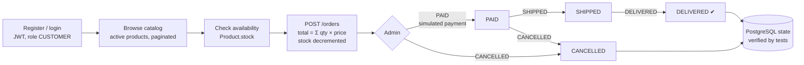
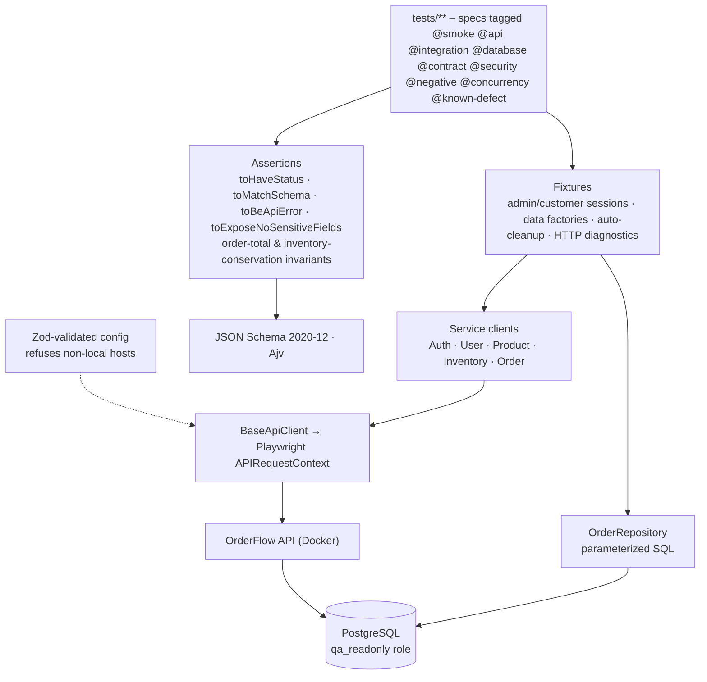
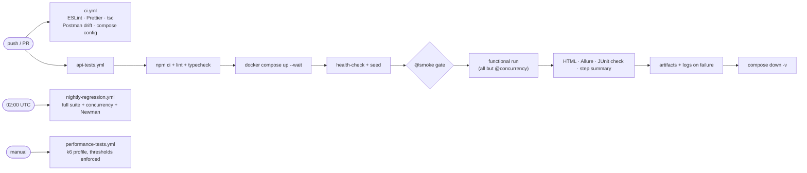
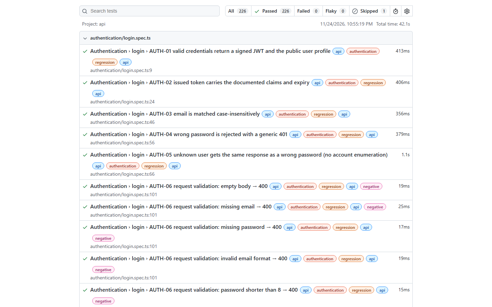
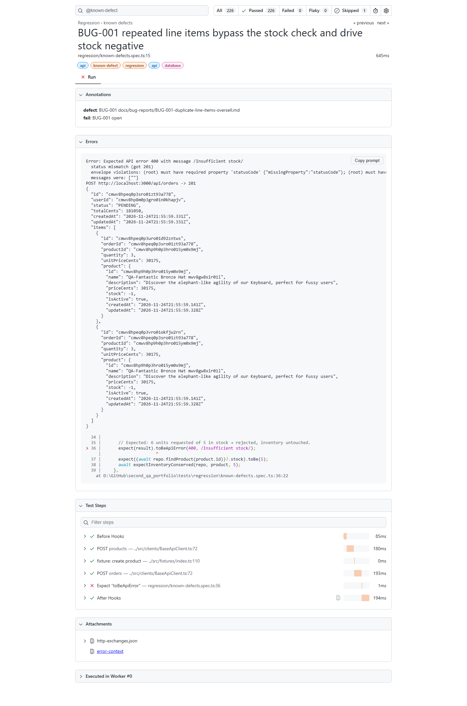
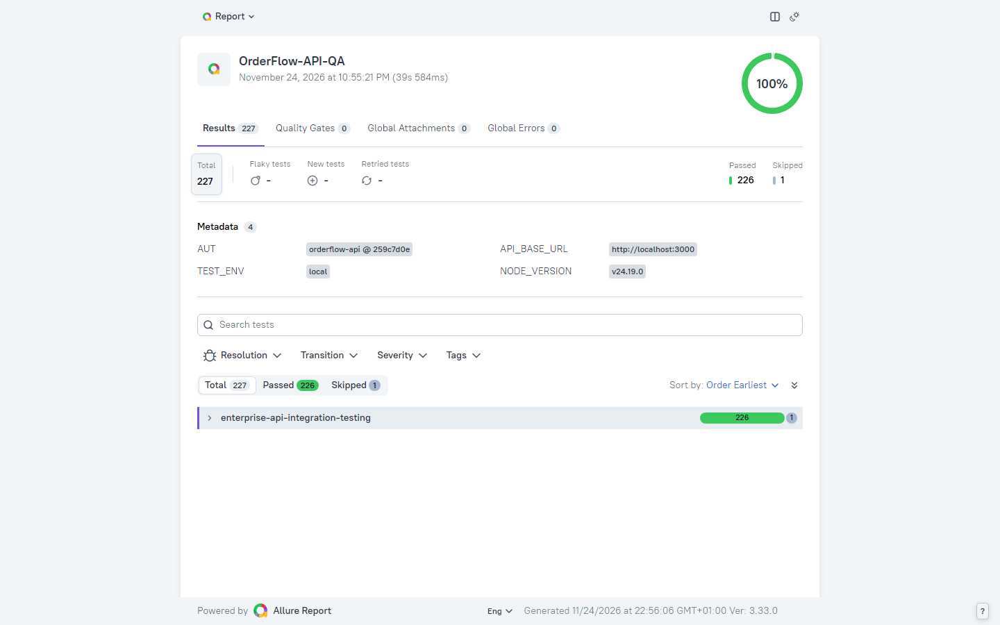
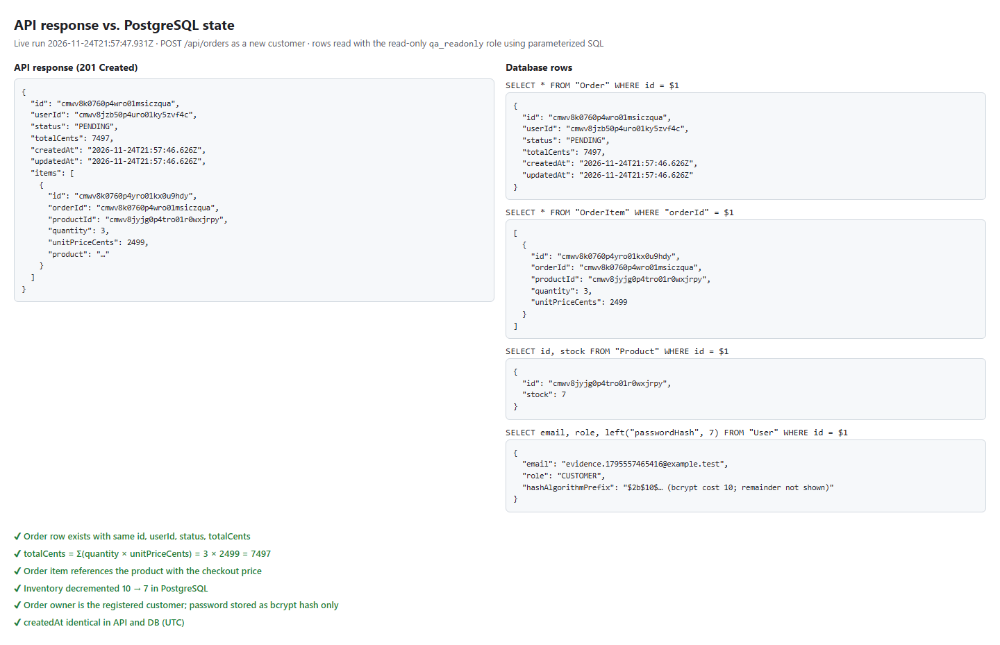
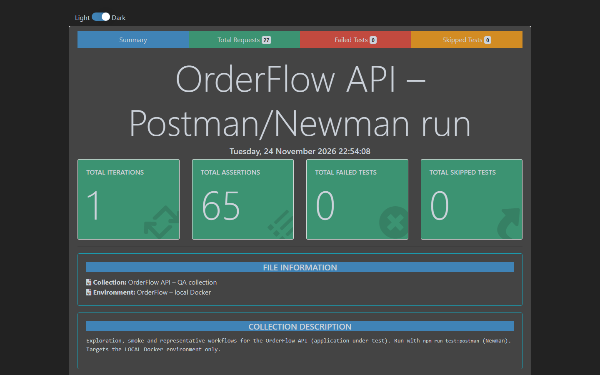
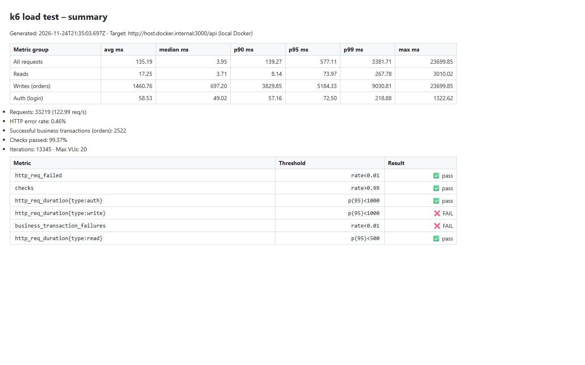

# Enterprise Order Management – REST API & Integration Testing Framework

[](https://github.com/Marcel-Kaczmarek/order-management-api-testing/actions/workflows/ci.yml)
[](https://github.com/Marcel-Kaczmarek/order-management-api-testing/actions/workflows/api-tests.yml)


> **An independent QA engineering portfolio project**, not commercial work. It is a production-style API, database and integration test framework for an open-source NestJS order management backend. It verifies business rules end to end, all the way into PostgreSQL, and has found **13 verified defects** plus 2 security findings, each with automated reproduction and root-cause analysis.

## At a glance (60-second summary)

|                     |                                                                                                                                                                                                                                                                             |
| ------------------- | --------------------------------------------------------------------------------------------------------------------------------------------------------------------------------------------------------------------------------------------------------------------------- |
| **What is tested**  | [OrderFlow API](https://github.com/andriiops/orderflow-api) (MIT, pinned at `259c7d0e`): JWT auth with RBAC, products and inventory, orders, and the payment → shipment → delivery lifecycle                                                                                |
| **Automated tests** | **227** Playwright API tests in 21 spec files, plus a 27-request Postman collection and 4 k6 profiles                                                                                                                                                                       |
| **Last full run**   | 212 passed · **14 known-defect reproductions failed as expected** · 0 unexpected failures · 0 flaky · 1 skipped (host-dependent precondition) · 42.1 s ([details](docs/test-execution-summary.md))                                                                          |
| **Defects found**   | Overselling (sequential **and** concurrent), phantom orders after 500 responses, acknowledged double payment confirmation, cancellations that don't restock, `"false"` stored as `true`, a container that can't start, and more → [bug reports](docs/bug-reports/README.md) |
| **Highlights**      | API ↔ PostgreSQL assertions with a read-only role · exhaustive state-machine tests · concurrency reproduction rates measured, never assumed · JSON Schema contracts · OWASP API Top 10 checks · self-validating requirements traceability · GitHub Actions quality gates    |

## Contents

[Business domain](#business-domain) · [Application under test](#application-under-test) · [Architecture](#test-automation-architecture) · [Features](#framework-features) · [Scope & coverage](#testing-scope--coverage) · [Repository structure](#repository-structure) · [Getting started](#getting-started) · [Running tests](#running-tests) · [PostgreSQL validation](#postgresql-validation-approach) · [Postman](#postman--newman) · [Performance](#performance-testing-k6) · [CI/CD](#cicd-pipeline) · [Reports & evidence](#reports--execution-evidence) · [Defects](#defect-reports) · [Engineering decisions](#key-engineering-decisions) · [Limitations](#known-limitations) · [Troubleshooting](#troubleshooting) · [License](#license--attribution)

## Business domain

The application models an order management slice: customers register and authenticate, browse an active product catalog with live inventory, and place multi-line orders. Prices are captured at checkout and stock is reserved immediately. Administrators then drive each order through a controlled state machine, with payment simulated by the `PAID` transition.



## Application under test

- **Upstream:** [`andriiops/orderflow-api`](https://github.com/andriiops/orderflow-api), MIT licence, vendored **unmodified** in [`application-under-test/`](application-under-test) at commit `259c7d0e` ([UPSTREAM.md](application-under-test/UPSTREAM.md)).
- **Why this one:** the alternative candidate (`exralvio/nestjs-order-api`) is `UNLICENSED`, so it can't be redistributed. Its database-per-tenant setup with RabbitMQ provisioning is also far less reproducible. The trade-off is documented: this AUT has no Redis or RabbitMQ, so messaging and cache tests are **out of scope rather than simulated**.
- **Stack:** NestJS 11, Prisma 6, PostgreSQL 16, Passport JWT (HS256, 1-day expiry), bcrypt, class-validator, Swagger at `/api/docs`.
- **API surface:** 13 operations, all covered, and verified against the published OpenAPI document (OAS-01).

| Method                | Path                                    | Auth                 |
| --------------------- | --------------------------------------- | -------------------- |
| POST                  | `/api/auth/register`, `/api/auth/login` | public               |
| GET                   | `/api/users/me` · `/api/users`          | JWT · ADMIN          |
| GET                   | `/api/products`, `/api/products/:id`    | public               |
| POST / PATCH / DELETE | `/api/products`, `/api/products/:id`    | ADMIN                |
| POST / GET            | `/api/orders`, `/api/orders/:id`        | JWT (owner or ADMIN) |
| PATCH                 | `/api/orders/:id/status`                | ADMIN                |

## Test automation architecture



The full layer diagram, design decisions and the CI pipeline diagram are in [docs/architecture](docs/architecture/README.md).

## Framework features

- **Typed Service Object Model.** Thin clients return `ApiResult<T>` (status, headers, typed body, error envelope, timing). Tests read as business scenarios: `api.as(customer).orders.create(...)`.
- **Domain matchers.** `toHaveStatus`, `toMatchSchema`, `toBeApiError(400, /Insufficient stock/)` and `toExposeNoSensitiveFields`. Every failure message includes the sanitized request and response.
- **Business invariants as assertions.** `expectOrderTotalConsistent`, `expectOrderPersisted` and `expectInventoryConserved` (stock + reserved units = initial stock).
- **Database verification** through a least-privilege, read-only PostgreSQL role, with parameterized queries and `pg_catalog` introspection.
- **Isolated, parallel-safe data.** Each test registers its own customers and products through the API, using seeded Faker for reproducible content plus a run token for unique keys. Products are soft-deleted on teardown.
- **Honest defect handling.** Verified defects are asserted as _correct_ behaviour under `test.fail()`. They stay visible in every report, and once a bug is fixed its test reports an unexpected pass and breaks the build.
- **Concurrency harness.** Simultaneous request bursts, bounded reproduction, measured reproduction rates, and `npm run repro:contention` for standalone evidence.
- **Safety and secrets.** A Zod guard blocks non-local targets. Tokens and passwords are redacted from logs and attachments, Playwright traces (which contain raw tokens) are opt-in, and there are no committed secrets.
- **Self-validating traceability.** `npm run docs:traceability` regenerates the RTM and test catalog from the live test inventory and fails if a requirement references a missing test.
- **Cross-platform tooling.** Node and tsx scripts (no Bash required), Docker fallback for k6, and proxy-safe Newman and k6 runners.

## Testing scope & coverage

| Area                         | Folder / tag                         | Tests | Examples                                                                                                       |
| ---------------------------- | ------------------------------------ | ----: | -------------------------------------------------------------------------------------------------------------- |
| Smoke                        | `tests/smoke` · `@smoke`             |     5 | catalog, admin login, register + profile, critical order path, OpenAPI                                         |
| Authentication               | `tests/authentication`               |    36 | claims/expiry, case-insensitive email, no account enumeration, expired / forged / `alg:none` / tampered tokens |
| Authorization                | `tests/authorization`                |    23 | RBAC per admin function, BOLA, list scoping, guard-before-validation                                           |
| Products & inventory         | `tests/products`                     |    38 | CRUD, partial update, soft delete, boundary values, pagination maths, ordering                                 |
| Orders & lifecycle           | `tests/orders`                       |    41 | totals, price snapshots, stock boundaries, atomicity, price tampering, **exhaustive transition table**         |
| Integration                  | `tests/integration`                  |     8 | 14-step order-to-delivery flow with DB checks, rollback on failure, cross-endpoint consistency                 |
| Database                     | `tests/database`                     |    12 | API ↔ row equality, bcrypt storage, unique/FK/NOT NULL constraints, orphans, read-only role                    |
| Contract                     | `tests/contract`                     |    13 | JSON Schemas for all responses, uniform error envelope, OpenAPI drift                                          |
| Negative & protocol          | `tests/negative`                     |    17 | malformed JSON, content types, unsupported methods, implicit type conversion                                   |
| Security                     | `tests/security`                     |    15 | OWASP API Top 10: data exposure, SQLi, error leakage, resource limits, brute force, headers, CORS              |
| Concurrency                  | `tests/concurrency` · `@concurrency` |    11 | oversell race, lost updates, double payment, ship-vs-cancel, duplicate registration, phantom orders            |
| Known-defect regression pack | `tests/regression` · `@known-defect` |     8 | one reproduction per sequential defect                                                                         |

Coverage is reported in three separate dimensions, which are never mixed:

- **Requirements:** 23/23 functional and non-functional requirements have automated tests, and 2 more are verified by k6 and environment evidence ([RTM](docs/requirements-traceability-matrix.md)).
- **Endpoints:** 13/13 OpenAPI operations.
- **Code coverage:** **not measured.** The AUT isn't instrumented, so no code-coverage figure is claimed.

## Repository structure

```text
order-management-api-testing/
├── application-under-test/      # Unmodified upstream AUT (MIT) + UPSTREAM.md
├── docker/                      # QA Dockerfile for the AUT, read-only DB role init
├── src/
│   ├── clients/                 # BaseApiClient, Auth/User/Product/Inventory/Order clients
│   ├── config/                  # Zod env, global setup/teardown
│   ├── constants/               # roles, statuses, transition table, tags, defect IDs
│   ├── fixtures/                # Playwright fixtures (sessions, data, cleanup, diagnostics)
│   ├── models/                  # typed requests/responses
│   ├── schemas/                 # JSON Schemas + Ajv validator
│   ├── factories/               # seeded Faker builders, boundary & invalid datasets
│   ├── database/                # DbClient, OrderRepository (read-only SQL)
│   ├── assertions/              # custom matchers, business invariants
│   └── utilities/               # sanitizer, logger, polling, JWT crafting, concurrency
├── tests/                       # smoke … concurrency, regression (known defects)
├── postman/                     # collection (generated from build-collection.ts) + environment
├── performance/                 # k6 smoke / load / stress / spike + shared lib
├── scripts/                     # setup, seed, health-check, cleanup, report, evidence, traceability, repro
├── docs/                        # strategy, plan, cases, RTM, risks, bug reports, exploratory notes, screenshots
├── .github/workflows/           # ci, api-tests, nightly-regression, performance-tests
├── docker-compose.yml · playwright.config.ts · tsconfig.json · eslint.config.js
└── PROJECT_STATUS.md
```

## Getting started

### Prerequisites

- **Node.js 22 or later** (tested on 24.19) and npm 10+
- **Docker** with Compose v2 (Docker Desktop on Windows/macOS, Docker Engine on Linux)
- Optional: a local [k6](https://k6.io) install (otherwise the `grafana/k6` Docker image is used)

### Installation

```bash
git clone https://github.com/Marcel-Kaczmarek/order-management-api-testing.git
cd order-management-api-testing
npm ci
npm run setup        # creates .env, builds and starts Docker Compose, waits for health, seeds reference data
npm run test:smoke
```

`npm run setup` is equivalent to `docker compose up -d --build --wait`, followed by `npm run health-check` and `npm run seed`.

### Environment configuration

All settings live in [`.env.example`](.env.example) and are validated with Zod at start-up. Highlights:

| Variable                         | Default                 | Purpose                                                                  |
| -------------------------------- | ----------------------- | ------------------------------------------------------------------------ |
| `API_BASE_URL`                   | `http://localhost:3000` | AUT URL. **Only local hosts are accepted.**                              |
| `DB_PORT`                        | `55432`                 | Host port for PostgreSQL (chosen to avoid clashing with local instances) |
| `DB_READONLY_USER` / `_PASSWORD` | `qa_readonly`           | Validation role, created by `docker/postgres/01-readonly-role.sh`        |
| `JWT_SECRET`                     | local-only value        | Shared with the local AUT so tests can craft expired and tampered tokens |
| `TEST_WORKERS` / `TEST_RETRIES`  | `4` / `0`               | Parallelism and retries (CI uses 1 retry with `failOnFlakyTests`)        |
| `FAKER_SEED`                     | `20261124`              | Reproducible test data                                                   |
| `ALLURE_RESULTS_DIR`             | `allure-results`        | Override if antivirus locks files (see troubleshooting)                  |

### Docker Compose

| Service    | Image                                                             | Port    | Notes                                                                              |
| ---------- | ----------------------------------------------------------------- | ------- | ---------------------------------------------------------------------------------- |
| `postgres` | `postgres:16-alpine`                                              | `55432` | TCP health check (avoids the "ready during init" trap), read-only role init script |
| `api`      | built from `application-under-test/` with `docker/aut.Dockerfile` | `3000`  | Runs migrations, seed and start. Health-checked on `/api/products`.                |

Useful commands: `npm run env:up`, `npm run env:logs`, `npm run env:down`, and `npm run env:reset` (destroys the volume for a pristine DB).

## Running tests

| Command                                                       | What it runs                                                                                        |
| ------------------------------------------------------------- | --------------------------------------------------------------------------------------------------- |
| `npm test`                                                    | Everything (227 tests)                                                                              |
| `npm run test:smoke`                                          | `@smoke`, the critical path (5 tests)                                                               |
| `npm run test:api`                                            | `@api` functional API tests                                                                         |
| `npm run test:auth`                                           | `@authentication` and `@authorization`                                                              |
| `npm run test:integration`                                    | `@integration` workflows                                                                            |
| `npm run test:database`                                       | `@database` PostgreSQL validation                                                                   |
| `npm run test:contract`                                       | `@contract` schemas and OpenAPI                                                                     |
| `npm run test:security`                                       | `@security` OWASP-inspired checks                                                                   |
| `npm run test:negative`                                       | `@negative`                                                                                         |
| `npm run test:concurrency`                                    | `@concurrency` (heavier, nightly in CI)                                                             |
| `npm run test:regression`                                     | `@regression` (all functional suites)                                                               |
| `npm run test:known-defects`                                  | `@known-defect` reproductions only                                                                  |
| `npm run test:postman`                                        | Postman collection via Newman                                                                       |
| `npm run test:performance[:load\|:stress\|:spike]`            | k6 profiles                                                                                         |
| `npm run report`                                              | Allure report + metrics summary · `npm run report:playwright` opens the HTML report                 |
| `npm run lint` · `npm run typecheck` · `npm run format:check` | Static quality gates                                                                                |
| `npm run cleanup`                                             | Deletes generated reports and soft-deletes leftover `QA-` products (`-- --reset` also wipes the DB) |
| `npm run repro:contention -- 12 3 5`                          | Standalone concurrency defect reproduction (BUG-002 / BUG-012)                                      |
| `npm run docs:traceability`                                   | Regenerates the RTM and test catalog from the live test inventory                                   |
| `npm run evidence`                                            | Captures report screenshots into `docs/screenshots/`                                                |

## PostgreSQL validation approach

1. **Least privilege.** The framework connects as `qa_readonly` (SELECT only, `default_transaction_read_only = on`). DB-12 asserts both of these and that an `UPDATE` is rejected.
2. **API first.** Data is always created through the public API, and the database is only _read_ to verify outcomes. All SQL is parameterized (`$1`, `ANY($1::text[])`).
3. **Meaningful oracles**, not just "row exists":
   - API values equal the stored values, timestamps included. Prisma stores UTC in `timestamp without time zone`, so a UTC type parser is required; this was found by a failing test.
   - `Order.totalCents = Σ(quantity × unitPriceCents)` for the test's orders.
   - **Inventory conservation:** `stock + Σ(units in non-cancelled orders) = initial stock`.
   - Integrity: the unique email index, the three foreign keys, NOT NULL columns and no orphan rows. Constraints are read from `pg_catalog`, because `information_schema` hides them from read-only roles.
   - **Rollback:** a failure _after_ the stock decrement leaves no partial data (INT-07).
   - **Acknowledged = persisted:** under concurrency, the number of 201 responses must equal the order rows (this caught BUG-012's phantom orders).

## Postman / Newman

The [collection](postman/collections/orderflow-api.postman_collection.json) has 7 folders: Authentication, Customers, Products, Inventory, Orders, Integration workflow and Negative scenarios. It is generated from [`postman/build-collection.ts`](postman/build-collection.ts), so scripts stay reviewable, and CI fails if the JSON drifts from its source. It features dynamic token extraction, pre-request data generation, chained IDs, JSON Schema checks and a BOLA scenario with a second customer.

```bash
npm run test:postman          # CLI + reports/newman/newman-report.html + JUnit
```

To use the GUI, import the collection and `postman/environments/local.postman_environment.json`.

Last local run: **27 requests, 65 assertions, 0 failures**.

## Performance testing (k6)

Four profiles ([`performance/`](performance)) share a single user flow: browse the catalog, re-authenticate on 10 % of iterations, and place an order on 20 % (then read it back). Thresholds are configurable (`P95_READ_MS`, `P95_WRITE_MS`, `MAX_ERROR_RATE`) and are **proposed portfolio acceptance criteria, not verified SLAs**:

`p95(read) < 500 ms` · `p95(write) < 1000 ms` · `p95(auth) < 1000 ms` · `http_req_failed < 1 %` · `checks > 99 %` · `business_transaction_failures < 1 %`

```bash
npm run seed                  # PERF- reference products with large stock
npm run test:performance      # smoke (2 VUs, 30 s); also :load, :stress, :spike
```

Measured on the reference host (a shared Docker Desktop machine, so the numbers are indicative only):

| Profile                 | Requests (req/s) | Read p95 |    Write p95 | HTTP errors |            Failed orders | Verdict                         |
| ----------------------- | ---------------- | -------: | -----------: | ----------: | -----------------------: | ------------------------------- |
| Smoke · 2 VUs · 30 s    | 1,744 (56/s)     |     5 ms | **1,277 ms** |      0.00 % |                  0 / 140 | ❌ write p95 threshold          |
| Load · 20 VUs · 4.5 min | 33,219 (123/s)   |    74 ms | **5,184 ms** |      0.46 % | **154 / 2,676 (5.75 %)** | ❌ write p95, business failures |

Reads scale well. Order creation is the bottleneck, and the 5.75 % failed checkouts under load match BUG-012 (transaction timeouts on a hot product row). Spike and stress results are in the [execution summary](docs/test-execution-summary.md).

## CI/CD pipeline



Quality gates: lint, format and type errors fail fast. The smoke gate blocks the functional run. Any unexpected failure **or flaky test** fails the build (`failOnFlakyTests`). A known defect that starts passing fails the build until its `test.fail()` marker is removed. k6 thresholds fail the performance job. `JWT_SECRET` comes from GitHub Actions secrets when configured, with a throwaway value for the ephemeral CI container. No secret is printed, and all reports are sanitized.

> The workflows are syntactically validated and mirror the commands executed locally. They have **not been run on GitHub yet**, because the repository has not been pushed.

## Reports & execution evidence

All screenshots below come from actual local runs on 2026-11-24 (`npm run evidence`).

| Playwright HTML report                                                     | Known-defect evidence (BUG-001)                                                 |
| -------------------------------------------------------------------------- | ------------------------------------------------------------------------------- |
|  |  |
| **Allure report**                                                          | **API ↔ PostgreSQL validation (live)**                                          |
|                      |                 |
| **Newman / Postman**                                                       | **k6 load summary**                                                             |
|                       |                                      |

Playwright and Allure count a known-defect test that fails _as expected_ as "passed" (Playwright semantics). The defects stay visible through the `@known-defect` tag filter, the `defect` annotation and the attached HTTP evidence. The generated metrics summary separates them explicitly: [docs/test-execution-summary.md](docs/test-execution-summary.md). Reports are written to `reports/` (Playwright HTML, Allure, JUnit XML, JSON, Newman, k6) and uploaded as CI artifacts.

## Defect reports

13 verified defects and 2 security findings in Jira format, each with environment, severity and priority, steps, **captured evidence**, database evidence, root cause (marked _verified_ or _hypothesis_), business impact and remediation. → [docs/bug-reports](docs/bug-reports/README.md)

| ID                              | Defect                                                                                                                         | Severity |
| ------------------------------- | ------------------------------------------------------------------------------------------------------------------------------ | -------- |
| BUG-001                         | Repeated line items bypass the stock check, so stock goes negative                                                             | High     |
| BUG-002                         | Concurrent checkouts oversell (12 orders accepted for 3 units, 10/10 runs)                                                     | High     |
| BUG-006                         | Concurrent status updates all acknowledged (8 × "PAID", or ship **and** cancel)                                                | High     |
| BUG-007                         | Upstream Docker image can't start (`dist/main.js` missing)                                                                     | High     |
| BUG-012                         | Checkout times out with 500 under contention, and "failed" orders can still be committed                                       | High     |
| BUG-003 · BUG-004 · BUG-011     | No restock on cancel · INT overflow → 500 · `"false"` stored as `true`                                                         | Medium   |
| BUG-005 · 008 · 009 · 010 · 013 | Inactive product visible · 413→500 · NUL byte → 500 · 401 labelled "Internal Server Error" · duplicate registration race → 500 | Low      |

## Key engineering decisions

1. **Pin and vendor the AUT, and never patch it.** Findings refer to a fixed version. The one packaging workaround (BUG-007) lives in a separate QA Dockerfile.
2. **Oracles come from the AUT's code, not REST folklore.** Login is `201`, validation errors are `400` (never `422`), unsupported methods are `404`, and there is no `415` or `429`. Each is documented and pinned by tests ([strategy §14](docs/test-strategy.md)).
3. **Explore before automating, and distrust your own framework.** Exploratory sessions corrected wrong oracles in the first draft of the suite (login is 201, implicit type conversion) and exposed four framework defects (UTC parsing, `information_schema` visibility, NUL encoding, report overrides). All are listed in the [exploratory notes](docs/exploratory-testing.md).
4. **Separate invariants from symptoms.** For example, CON-01 checks "no lost updates" while CON-11 owns the timeout defect, so neither test is flaky.
5. **Measure flakiness and reproduction rates.** Concurrency tests ran under `--repeat-each=5`, and rates are reported in every bug report.
6. **Keep the build green without hiding anything.** Known defects stay visible as expected failures, and nothing is skipped or disabled to look green. The single runtime skip (CON-11) states its reason in the report.

## Known limitations

- Performance numbers come from a shared developer machine (Docker Desktop running other stacks) and are indicative only.
- BUG-012's reproduction depends on host speed. CON-11 self-skips when the 5 s timeout isn't reached.
- Schema tests pin the provider's _current_ shape. This is **not** consumer-driven contract testing (no Pact).
- Users and orders can't be deleted through the API, so test data accumulates until `npm run env:reset`.
- There are no Redis, RabbitMQ, refresh-token, payment-provider or audit-log tests, because the AUT has none of these.
- GitHub Actions workflows have not been executed on GitHub yet (see [PROJECT_STATUS.md](PROJECT_STATUS.md)).

## Future improvements

- Consumer-driven contracts (Pact) for a real consumer, and OpenAPI response-schema generation once the AUT declares `@ApiResponse` types.
- Code coverage of the AUT via `c8` / NYC instrumentation in a dedicated coverage build.
- Mutation testing of the state machine (Stryker) to measure oracle strength.
- A k6 → Prometheus/Grafana dashboard and trend storage across runs.
- Contributing upstream: fix PRs for BUG-001/002/006/012, each with these tests as acceptance criteria.

## Troubleshooting

| Symptom                                                           | Cause / fix                                                                                                                                                               |
| ----------------------------------------------------------------- | ------------------------------------------------------------------------------------------------------------------------------------------------------------------------- |
| `docker compose up` hangs or fails to build                       | Check `docker info`. Behind a corporate proxy, export `HTTP_PROXY`/`HTTPS_PROXY` (forwarded as build args). On a cold cache the first build downloads about 300 MB.       |
| `port is already allocated` (3000 / 55432)                        | Change `API_PORT` / `DB_PORT` in `.env` (and `API_BASE_URL` to match), then run `npm run env:up`.                                                                         |
| API container exits with `Cannot find module '/app/dist/main.js'` | You built the upstream Dockerfile directly (BUG-007). Use the root `docker-compose.yml`, which uses `docker/aut.Dockerfile`.                                              |
| `ECONNREFUSED` / health check fails                               | `npm run env:logs`. Migrations run on start, so wait for `listening on`, then run `npm run health-check`.                                                                 |
| PostgreSQL connection or authentication failure                   | Make sure `DB_PORT`/`DB_READONLY_*` match the compose values. The read-only role is only created on **first** init, so run `npm run env:reset` if the volume predates it. |
| `Admin login failed` in global setup                              | The DB wasn't seeded (the API seeds on start). Run `npm run env:reset`.                                                                                                   |
| 502 Bad Gateway for `localhost` with curl, Newman or k6           | A proxy is intercepting local traffic. Set `NO_PROXY=localhost,127.0.0.1` (the npm runners do this automatically).                                                        |
| 409 conflicts or unexpected data in tests                         | Leftover data in a long-lived DB. Run `npm run cleanup`, or `npm run env:reset` for a pristine state.                                                                     |
| `EBUSY: resource busy or locked … allure-results` (Windows)       | Antivirus is locking fresh files. Set `ALLURE_RESULTS_DIR` to a folder outside the scanned drive, or exclude the project folder.                                          |
| `npm run report` says no results                                  | Run a test command first. Allure reads `allure-results/` (or `ALLURE_RESULTS_DIR`).                                                                                       |
| k6 can't reach the API from Docker                                | The runner rewrites `localhost` to `host.docker.internal` and adds `--add-host=host.docker.internal:host-gateway` for Linux.                                              |

## License & attribution

- Framework code and documentation: [MIT](LICENSE).
- Application under test: [OrderFlow API](https://github.com/andriiops/orderflow-api) © 2026 OrderFlow API Contributors, MIT ([application-under-test/LICENSE](application-under-test/LICENSE)). It is included unmodified for testing purposes. The defects reported here refer to commit `259c7d0e`.
- This is an independent portfolio project. It is not affiliated with the upstream authors or with any employer.
