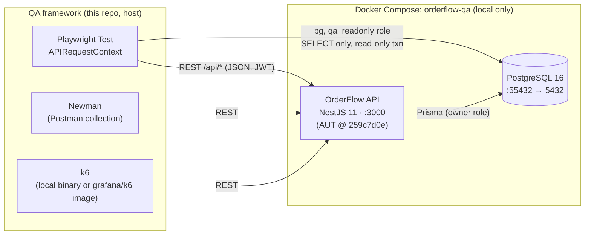
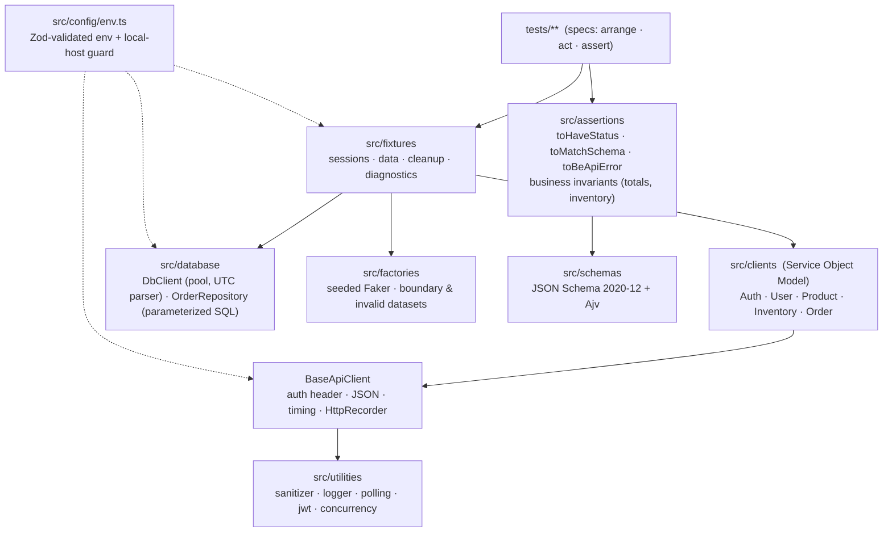
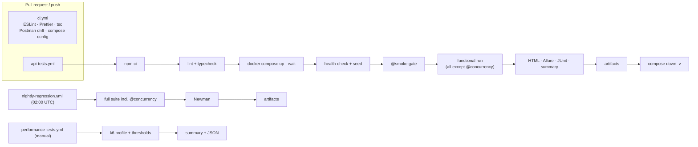
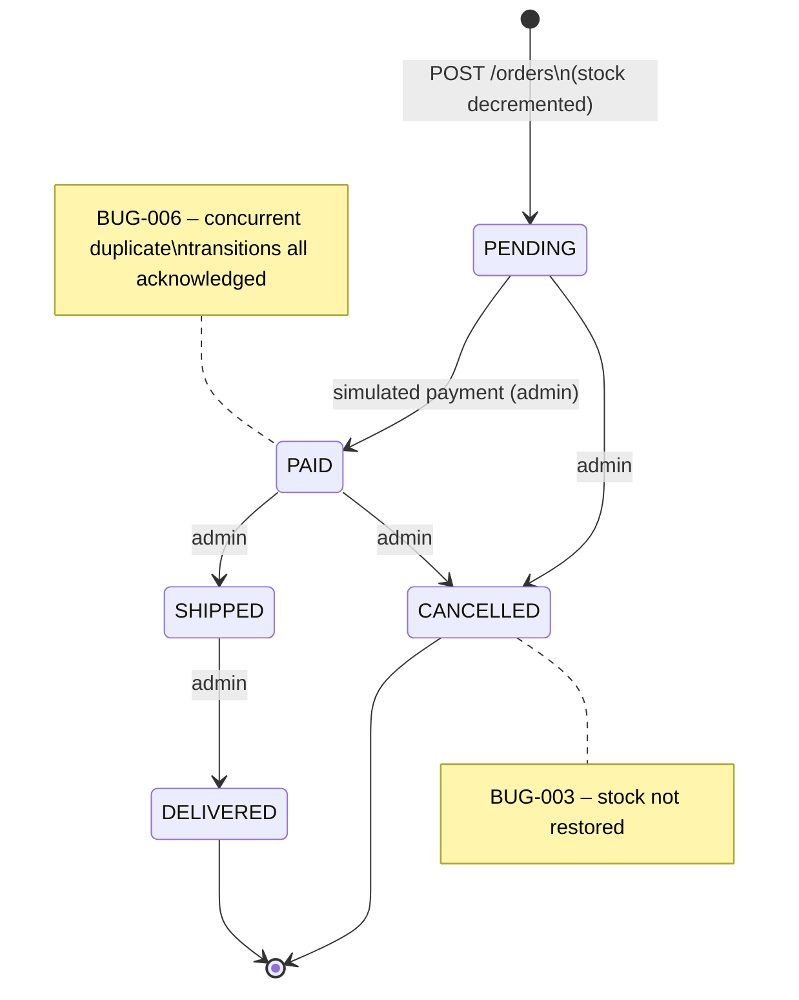

# Architecture

## System context

The AUT is the only writer to the database. The framework creates data **through the API only** and reads PostgreSQL with a least-privilege role to verify outcomes. Test DB-12 proves that this role can't write.

## Framework layers

| Layer      | Responsibility                                                                                 | Does **not**                                       |
| ---------- | ---------------------------------------------------------------------------------------------- | -------------------------------------------------- |
| Clients    | Build requests, attach the bearer token, parse JSON, time requests, record sanitized exchanges | Assert anything                                    |
| Fixtures   | Authenticate actors, create and clean up data, attach diagnostics on failure                   | Contain test logic                                 |
| Assertions | Encode the oracles (status, schema, envelope, invariants) with diagnostic messages             | Call the API, except for invariant reads           |
| Repository | Read-only parameterized SQL for verification                                                   | Write data                                         |
| Tests      | Describe behaviour in business language                                                        | Build URLs or JSON by hand (except protocol tests) |

## Key design decisions

| Decision                                           | Rationale                                                                                            |
| -------------------------------------------------- | ---------------------------------------------------------------------------------------------------- |
| Vendor the AUT unmodified, pinned to a commit      | Reproducible runs, and findings stay valid for a known version                                       |
| Separate QA Dockerfile (same build stages)         | The upstream image can't start (BUG-007), and its runner stage is very slow on Docker Desktop        |
| `test.fail()` for verified defects                 | The build stays green without hiding defects. A fix triggers an "unexpected pass" and forces cleanup |
| Strict schemas (`additionalProperties: false`)     | Catches excessive data exposure and contract drift                                                   |
| Read-only DB role                                  | Validation can't corrupt state, even by mistake                                                      |
| Tags, not folders, select suites                   | One test can belong to several slices (for example `@security` + `@database`)                        |
| Sanitized HTTP exchange attachments, traces opt-in | Reports are CI artifacts, and Playwright traces contain raw bearer tokens                            |
| Relative assertions on shared collections          | `fullyParallel` safety: no test depends on global counts                                             |
| Measured reproduction rates for races              | Timing-dependent defects are reported with evidence, not assumed                                     |

## CI/CD pipeline

## Business workflow under test

